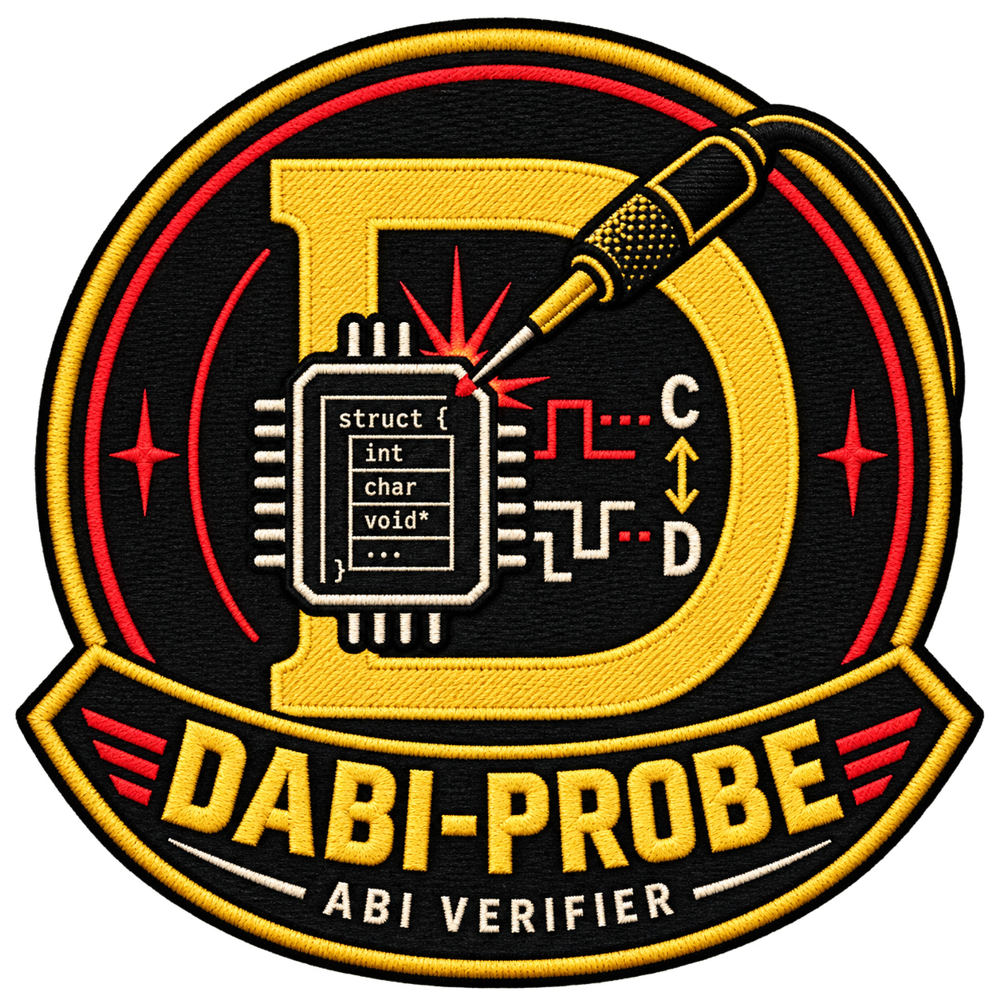

# dabiprobe



**Check your D bindings against what the C compiler actually sees!**

dabiprobe helps maintainers catch binding regressions when declarations, compilers,
or build flags change. It compiles independent C probes, reflects the selected D
declarations, and runs optional cross-language assertions. It does not generate
bindings or replace ImportC.

## Build and run

Requires a GCC/Clang-compatible C11 driver and LDC or DMD targeting the same
runnable host ABI. The verifier uses only the D standard library.

```sh
mkdir -p .artifacts
ldc2 -i -Isource -of=.artifacts/dabiprobe -od=.artifacts source/app.d

./.artifacts/dabiprobe --output .artifacts/packet-check examples/packet/manifest.json
```

Alternatively, `dub build` writes the executable to `.artifacts/`.
Windows executables use `.exe`. `--cc` and `--dc` select compiler executables;
defaults are `cc` (`clang` on Windows) and `ldc2`.

## Reuse your declarations

Select names rather than maintaining another copy of the binding:

```json
{
  "headers": ["packet.h"],
  "imports": ["packet"],
  "types": [
    {"c": "struct Packet", "d": "Packet", "fields": "*"}
  ],
  "constants": [
    {"c": "PACKET_LIMIT", "d": "packetLimit"}
  ]
}
```

`fields: "*"` discovers the D members. Function entries can likewise contain only
`c` and `d` names; the D compiler supplies their signatures. Checks include field
representations, array elements, and supported callback types—not just sizes.
Explicit field mappings and function contracts remain available.
Opaque handle mappings use `opaque: true`; their object layout stays unchecked.

Supply the project's actual compiler arguments in `cFlags` and `dFlags`.
Relative input paths resolve from the manifest directory. Named `configurations`
append variant-specific flags; run all variants or select one with `--config NAME`.

The [BindBC-GLFW case study](docs/glfw-case-study.md) uses a pinned real binding,
headless library calls, and clearly labeled injected regressions. The smaller
[packet](examples/packet/manifest.json) and [interop](examples/interop/manifest.json)
examples introduce the basic checks.

## Read and reproduce results

Results distinguish **measured agreement** from **executed behavior assertions**.
Each check identifies its declaration, property, configuration, and outcome:

| Outcome | Meaning |
| --- | --- |
| `checked` | Selected measurement agrees, or an explicit assertion returned true |
| `mismatched` | A measured property or assertion disagrees |
| `unchecked` | Property unexamined, or execution deliberately skipped |
| `unsupported` | A requested contract cannot be represented by the checker |
| `failed_execution` | A required operation could not complete |

Exit codes are `0` for no disagreement in supported executed checks, `1` for a
mismatch, `2` for an input/execution error, and `3` for an unsupported or otherwise
incomplete requested check.
Unchecked and unsupported properties never count as passed checks.

`--output NEW_DIR` saves `report.json`, the effective configurations, generated
sources, exact commands, and diagnostics. Probe failures otherwise retain private
evidence and print its location. Existing output directories are never overwritten.

```sh
python3 .artifacts/packet-check/replay.py
```

Replay rebuilds the captured probes without dabiprobe. Headers, binding modules,
libraries, and compatible compilers remain external dependencies. Changed D
declarations or targets require a fresh dabiprobe run, not stale generated checks.

## Scope

A pass is evidence for the selected properties and assertions, not the entire
binding. C-member completeness, ownership, lifetimes, and untested behavior are
not inferred. Header agreement does not certify an arbitrary prebuilt library.

**Use trusted inputs.** Compilation, constructors, and assertions can execute
code; there is no sandbox or subprocess timeout. Evidence may contain project
sources, paths, and build flags, so review it before sharing.

See `dabiprobe --help`, the [manpage](docs/dabiprobe.1), and the
[related-work comparison](docs/related-work.md) for details.

## Test

```sh
python3 tests/integration.py .artifacts/dabiprobe --cc cc --dc ldc2
```

The suite uses real compilers. Python 3.10+ is required; Windows replay tests need
Python 3.13+ for private temporary-directory support.

## License

[BSD 2-Clause](LICENSE). Copyright (c) 2026
[GuestAUser](https://github.com/GuestAUser).
